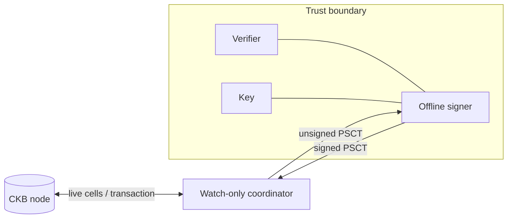

# KeyMe

**Open, verifiable signing for Nervos CKB.**

KeyMe is an open standard for CKB transaction signing — PSCT — and a reference signer. It separates the machine that builds a transaction from the machine that holds the key. The coordinator is untrusted; the signer verifies the bytes and signs only what it can prove.

PSCT is to CKB what PSBT is to Bitcoin: a portable container that lets independent tools build, inspect and sign the same transaction. The software stack covers stages 0–2 of the [implementation plan](docs/02-implementation-plan.md). The radio-less hardware reference is the next step.

Closed CKB signing products exist. What is missing is an open, inspectable standard and signer that any tool can implement.

## Why PSCT

A CKB signature commits to the transaction, not to the capacity of the cells it spends. A signer that trusts a supplied cell output can be tricked into approving an enormous fee.

PSCT binds every input to the transaction that created it. The signer hashes each proof, decodes the previous output, checks the lock and type against its registry, computes the fee, and displays what it verified. If a byte does not bind, it refuses.

Four rules follow from that:

1. **The verifier is the product.** Every displayed value comes from bytes that were hash-bound. Labels are not trusted.
2. **The coordinator is untrusted.** It proposes a transaction; it never holds a key.
3. **Unknown means refuse.** An unregistered lock or type is a hard failure, not a warning.
4. **The signer has no network code.** The software signer runs offline on a general-purpose machine; the radio-less reference is intended to make that separation physical.

## Architecture



The coordinator gathers live cells, builds the raw transaction and resolves the proofs. The signer is the trust boundary: it verifies the PSCT, shows the transaction, and signs. The coordinator combines signatures, finalizes, and broadcasts.

## PSCT v0

PSCT v0 is a canonical CBOR envelope around a molecule `RawTransaction`.

| Part | What it carries |
|---|---|
| `tx` | The raw CKB transaction |
| `proofs` | For every input, the transaction that created it and the output index |
| `headers` | Block headers required by DAO and `since` rules |
| `witnessTemplates` | Non-signature witness fields, including DAO header indices |
| `account` | Optional paired xpub for change certification |

The full format is in [`spec/psct-v0.md`](spec/psct-v0.md).

Two hashes matter:

- `tx_hash` covers the raw transaction and excludes witnesses. It is the transaction ID.
- `full_tx_hash` covers the witnesses as well. It is the finalization check: the signed bytes must correspond to the transaction that was reviewed.

The container is **finalize-or-throw**. A missing proof, an unknown script, a non-canonical encoding, or an unbound change output stops the process; there is no partial or best-effort output.

## Status

| Area | State |
|---|---|
| PSCT v0 | Frozen; canonical CBOR, witness templates and hash-bound input proofs |
| Verifier | 42 hostile + 26 container/interop tests (68 total); 13 offline fixtures |
| Coordinator | Transfer, multisig, DAO deposit/prepare/withdraw, xUDT mint/transfer |
| Offline signer | Binds, displays, refuses, signs; paired-account change certification |
| Rust implementation | Byte-identical `tx_hash` and `full_tx_hash`; 3/3 conformance vectors |
| Testnet | Transfer at block 23,084,406; 2-of-3 payout at block 23,086,201 |
| Devnet | DAO deposit → prepare → withdraw; xUDT mint → transfer |
| Hardware | Radio-less reference: design stage (no units yet) |
| Audit | Not yet |

The testnet runs are public. The DAO and xUDT runs are reproducible on a devnet with the demo scripts. Not modelled, and refused: OmniLock auth schemes, JoyID, NostrLock, Spore clusters and DIDs.

## Quick start

```bash
git clone https://github.com/WuodOdhis/keyme
cd keyme/packages/psct-core
npm install
npm test
npm run conformance   # Rust toolchain required
```

`npm test` runs the hostile verifier suite, the container/interop suite and the offline fixture check. `npm run conformance` compares the independent Rust implementation against the signed vectors.

Inspect a transaction or run the attack demo:

```bash
npx tsx src/cli.ts inspect <txhash> --json
npx tsx src/cli.ts verify  <txhash>
npx tsx src/cli.ts redteam
```

Build, sign, finalize and broadcast a PSCT:

```bash
npx tsx src/apps/coordinator.ts transfer --network testnet \
  --from <address> --to <address> --amount 10 --out transfer.psct.b64

npx tsx src/apps/signer.ts sign transfer.psct.b64 \
  --privkey-file key.hex --out signed.psct.b64

npx tsx src/apps/coordinator.ts finalize signed.psct.b64 --out tx.json
npx tsx src/apps/coordinator.ts send tx.json --network testnet
```

The full CLI reference, including DAO and xUDT construction, is in [`packages/psct-core/README.md`](packages/psct-core/README.md).

For a local end-to-end run, start `offckb node` and use `npm run demo`, `npm run dao-demo` or `npm run xudt-demo`.

## Repository

| Path | What |
|---|---|
| `spec/psct-v0.md` | The PSCT v0 specification |
| `packages/psct-core` | TypeScript codec, verifier, coordinator and signer |
| `packages/psct-core/fixtures` | Mainnet, testnet and devnet fixtures with proofs |
| `packages/psct-core/vectors` | Signed conformance vectors |
| `packages/psct-rs` | Independent Rust implementation |
| `docs/00`–`docs/05` | Research, findings, plan, portability contract, stage 2 record, threat model |
| `demo/` | Concept animation of the PSCT flow |
| `LICENSE` | MIT |

## Demo

A self-contained concept animation of the flow lives in [`demo/`](demo/). It is a simulation, not the verifier.

- Live: https://wuododhis.github.io/keyme/demo/ckb-airgap-demo.html
- Recordings: `demo/ckb-airgap-demo.gif`, `demo/ckb-airgap-demo-tamper.gif`

## Security

KeyMe has not been audited. Do not use the software signer for mainnet savings.

- The software signer has no network code, but it runs on a general-purpose computer. It is not a hardware air gap yet; the radio-less reference is planned.
- The signer refuses unknown lock and type scripts, non-canonical CBOR and unbound proofs, and certifies change against its paired account when one is configured.
- The coordinator never holds a key.
- Thresholds and residual risks are documented in [`docs/05-threat-model.md`](docs/05-threat-model.md).
- Report vulnerabilities through GitHub's private security advisory, not a public issue.

## Prior art

The 2021 [CKB Offline Transaction Signing Scheme](https://talk.nervos.org/t/rfc-draft-ckb-offline-transaction-signing-scheme/5794) draft by Xuejie Xiao and the 2022 [CKB Open Transaction](https://github.com/nervosnetwork/ckb/discussions/3607) project both described parts of this problem. KeyMe is the working implementation: PSCT v0, a verifier and a signer. The 2021 draft's Pico direction is the hardware path.

## Contributing

PSCT v0 is frozen. A format change needs a new version and a migration note. Open an issue before a pull request. `npm test` and `npm run conformance` must pass. Fixtures are public chain data; never add private keys.

Security reports go through GitHub's private advisory.

## License

MIT. See [`LICENSE`](LICENSE).

Maintained by [@WuodOdhis](https://github.com/WuodOdhis) and [@xmoshte](https://github.com/xmoshte).
