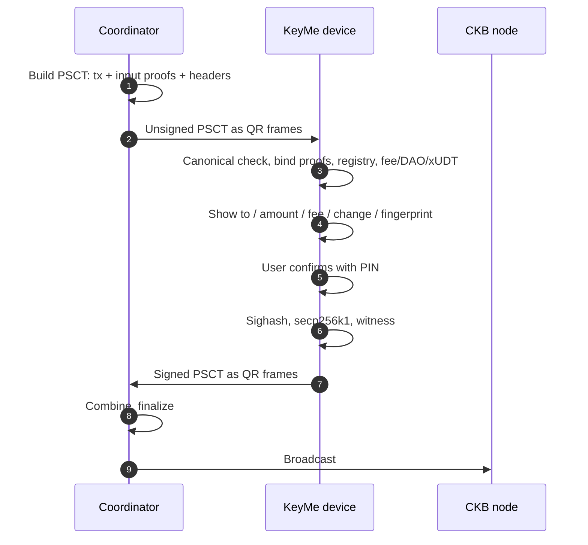
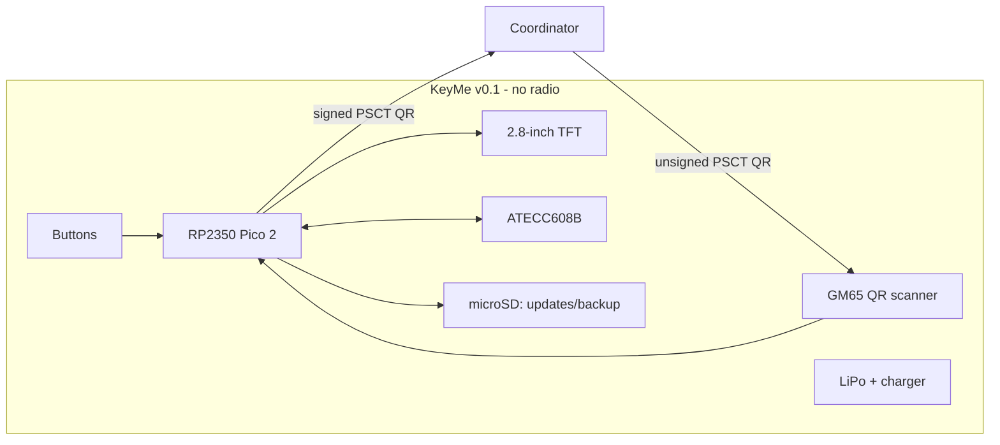

# [DIS] KeyMe — CKB's PSBT: Open Air-Gapped Signing and the First DIY Hardware

If you have used a Bitcoin hardware wallet, the flow is familiar.

A watch-only app builds a transaction. It hands it to a small device as a QR code or a file. The device shows the amount and the destination. You approve. The signed transaction goes back to the app, which broadcasts it. The machine that holds the key never talks to the internet.

Bitcoin calls that container a **PSBT** (Partially Signed Bitcoin Transaction). The devices have names you may know: Coldcard, SeedSigner, Specter DIY. They do not share one design. They share one rule: the key lives on a device that cannot reach the network, and the device shows you what you are signing.

CKB has a software offline workflow in Neuron, but no open, radio-less hardware equivalent. CKB transactions are not Bitcoin transactions. They carry cells, lock and type scripts, DAO state, xUDT amounts and multisig. A Bitcoin device cannot read them. In 2020, a grant added a Ledger app for CKB; it is a closed device. There is still no open, radio-less CKB signer that a community can inspect, build and improve.

KeyMe is the CKB version. PSCT is the container, CKB's equivalent of PSBT. KeyMe is the signer, a small, radio-less device that reads the PSCT, checks every byte, shows the transaction, and signs only after you approve. The first hardware is built on a Pico 2: a small board with a screen, a QR scanner, no radio, and no operating system. It is not a clone of a Bitcoin device; it is the shape that fits CKB.

## The one-minute version

PSCT — a Partially Signed CKB Transaction — is a file with three parts: the transaction, a proof for every coin it spends, and the block headers the scripts need. The device checks that each proof hashes to the coin it claims, decodes the previous output, checks the script against its registry, and shows the amount, destination, fee and change. It signs only after you confirm. It never trusts the coordinator's summary, an address label, or a script it does not know.

## The idea is not new

In 2020, a CKB grant added a Ledger app for CKB ([Nervos Talk](https://talk.nervos.org/t/4349)). It proved the demand; it is a closed device.

In May 2021, Xuejie Xiao (@xxuejie), a CKB core developer, posted "RFC Draft: CKB Offline Transaction Signing Scheme" ([Nervos Talk](https://talk.nervos.org/t/rfc-draft-ckb-offline-transaction-signing-scheme/5794)). It separated transaction assembly from signing, defined the data the signer needs, described the review step, and ended with this:

> As a side project, I do plan to build a Raspberry Pi Pico powered, air gapped offline transaction signing app. With a Cortex-M0+ chip and 264 KB RAM, the Pico should be more than enough to power such an offline signing design.

It stayed a draft. The Pico build never shipped.

In September 2022, @doitian opened "CKB Open Transaction" to describe a partial CKB transaction that multiple parties can build over time ([GitHub discussion](https://github.com/nervosnetwork/ckb/discussions/3607)). The hardware wallet is the final signer in its example:

> One party works on an open transaction, changes it, and hands it to the next participant. For example, the indexer collects input cells for a user; the dApp creates the unsigned transaction based on the inputs; and the hardware wallet finally signs the transaction.

The discussion cites Bitcoin's PSBT as prior work. The project produced an alpha demo and an RFC; the RFC was closed without merging, and the project closed in 2024. No open hardware signer shipped.

The 2021 draft planned the offline signer. The 2022 project planned the partial transaction format. Both named the hardware wallet. Neither shipped an open device. Neuron already supports an offline signing workflow, including offline multisig, but it keeps the key on an offline general-purpose computer. KeyMe is the hardware half: PSCT v0 is the signed container, and the Pico 2, the current Pico, is the device. v1 stays focused on the hardware and the PSCT container; v2 will explore potential pathways with Neuron.

KeyMe keeps the 2021 goal and changes what building it taught us: canonical CBOR instead of a molecule envelope; hash-bound proofs instead of full input transactions; per-script-group signatures; a registry that refuses unknown scripts; finalize-or-throw. We did not carry the draft's Lua signing path. A signer that executes arbitrary scripts is not a signer we can verify. The 2021 draft is the ancestor; PSCT v0 is the working version.

**Grant requested:** $9,500, in five payments of $1,900. **ETA:** 3.5 months from approval. **What you get:** three assembled units (two for independent testers), open firmware, open hardware, and documentation.

## What is already built

KeyMe's software is not a paper design. It is the oracle the hardware will be tested against.

| Layer | Status |
|---|---|
| PSCT v0 | Frozen. Canonical CBOR, molecule, hash-bound input proofs, witness templates. |
| Verifier | 42 hostile tests. Refuses unknown locks and types; never guesses. |
| Coordinator + signer | CLI. Builds, binds, displays, refuses, signs, finalizes. |
| Second implementation | Rust. Byte-identical `tx_hash` and `full_tx_hash`; 3/3 conformance vectors. |
| Testnet | Transfer at block 23,084,406. 2-of-3 payout at block 23,086,201. |
| Devnet | DAO deposit → prepare → withdraw; xUDT mint → transfer. Reproducible with the demo scripts. |
| Hardware | Board selected: Pico 2 (RP2350). Build starts with this grant. |

The testnet transfer is [0xbb10d0b6…1a85](https://explorer.nervos.org/transaction/0xbb10d0b6fb9ad72f6618f29020a1f065e73b4435f5ce24515afcbcb5c50a1a85); the 2-of-3 spend is [0x0ea1b375…535f](https://explorer.nervos.org/transaction/0x0ea1b3755a6a9610d266a791f2adb0b8c484e6fa1fe203ccfccffedfddbd535f). The DAO and xUDT runs are devnet, not public chain; the scripts are in the repository. In total: 68 tests, plus the Rust conformance run. The repository is `https://github.com/WuodOdhis/keyme`; the spec is `spec/psct-v0.md`.

## What this grant delivers

- **Three assembled units.** Two go to independent testers; one stays with the project for demos. A fourth parts set is the spare.
- **Firmware v0.1.0** for the RP2350: PSCT parsing, proof binding, script registry, DAO/xUDT display, secp256k1 signing, QR in/out, PIN and encrypted seed, signed boot.
- **A host QR page.** A static page that turns a PSCT into animated QR and scans the signed frames with a phone camera. No server, no keys.
- **Open hardware.** Carrier board, schematic, BOM, 3D-printable case.
- **Documentation.** Build guide, flashing, test report, demo video, threat model.
- **Licences.** MIT/Apache-2.0 for code, CERN-OHL-S-2.0 for hardware, CC-BY-4.0 for docs.

## How it works

The coordinator proposes; the device verifies.

The device trusts only three things: the canonical PSCT bytes, proofs that hash to the inputs they claim, and its own account and script registry. If a lock or type is unknown, it refuses. If the CBOR is non-canonical, it refuses. If the proof, network or header is wrong, it refuses. There is no "proceed anyway" button.

The device has no operating system, no shell and no network stack. The firmware is the only code. The RP2350 boots from signed flash; the seed is BIP39, encrypted at rest with a PIN and the ATECC608B key, and decrypted only while signing. USB is power-only while signing; QR is the data path. v0.1 has no third-party audit and no lab-grade physical security; that is a v0.2 conversation.

## Demo

A short concept animation shows the flow: the coordinator builds the PSCT, the frames cross the air gap, the device audits the input proofs and change lock, and a malware-swapped change output is refused. It is a simulation, not the protocol; the QR grid is illustrative, and the real verifier is the test suite. The automatic refusal is the change-output check; the destination remains a human check.

*Click the still to open the interactive demo.*

**Normal flow**

**Tamper: a swapped change output is refused**

## Hardware

The units are off-the-shelf modules on a carrier board. No custom injection mold, no custom silicon.

Why these parts:

- **Pico 2 (RP2350):** no radio, 520KB RAM, 150MHz, Rust, secure boot, $6. No OS, instant boot, and it is in stock.
- **GM65:** decodes QR inside the module over UART. No camera pipeline, no DSP, no large framebuffer.
- **2.8-inch TFT:** review screen and animated QR.
- **ATECC608B:** stores the key that encrypts the seed at rest. It does not sign secp256k1; the RP2350 does. I am not claiming a secure enclave in v0.1.
- **microSD:** signed firmware updates and a backup. It is not the running OS.
- **LiPo + charger:** signing does not need a cable.

No ESP32: radio. No phone: radio and a large attack surface. No Pi SBC (Zero, 3, 4, 5): a full OS and radio. The Pico 2 is a microcontroller: no OS, no radio, instant boot.

BOM for four units (three plus a spare):

| Part | Qty | Cost |
|---|---:|---:|
| RP2350 Pico 2 | 4 | $24 |
| 2.8-inch TFT | 4 | $72 |
| GM65 QR scanner | 4 | $120 |
| ATECC608B | 4 | $20 |
| microSD | 4 | $16 |
| LiPo + charger | 4 | $40 |
| Buttons, headers, wire | 4 | $40 |
| Carrier PCB (5 pcs) | 1 | $40 |
| 3D-printed case | 4 | $40 |
| Tools/consumables | 1 | $100 |
| Shipping to testers | 1 | $50 |
| **Total** | | **$562** |

One unit is about $100 in parts (v2 should be significantly cheaper once we have the hardware supply chain right). The build guide is the point: anyone can make one.

## Milestones

3.5 months, five payments of $1,900: the first at approval, then one after each milestone. Each milestone payment follows a public report and the committee's check.

| # | Week | Work | Acceptance |
|---|---|---|---|
| Kickoff (M0) | 1 | Order hardware; publish repo and licences; firmware skeleton; PSCT parser, sighash, secp256k1; signed boot | The device signs the three conformance vectors; host verifier accepts; BOM and block diagram published |
| M1 | 3 | Scanner input; review UI; PIN and encrypted seed; host QR page | Scan unsigned PSCT, review, sign, return signed PSCT, finalize a testnet transfer; video |
| M2 | 6 | Three units on carrier board; case; battery; testers | Each unit signs a testnet transfer; two units shipped; build guide draft |
| M3 | 10 | Hostile tests; DAO and xUDT paths; firmware v0.1.0 | 20+ adversarial tests pass on device; signed image verified; test report |
| M4 | 14 | Docs, BOM, schematics, STL, flashing, video; independent build | A third party builds a unit and signs a testnet transaction; final report |

The first payment is released at approval and funds the hardware order. The kickoff report at week 1 is reviewed before the M1 payment.

The minimum viable outcome is one working unit plus open firmware and docs. If something has to give, the cut order is spare unit → custom carrier board → ATECC. The firmware and docs are never cut.

## Budget

| Category | Amount | What it covers |
|---|---:|---|
| Development | $7,638 | Firmware, host QR page, carrier board design, tests. About 400 hours over 14 weeks at a community rate. |
| Hardware | $562 | Four units, PCB, case, tools, shipping. The BOM above, at cost. |
| Documentation | $600 | Build guide, photos, demo video, test report, Chinese translation. |
| Independent review | $700 | Firmware review by an embedded developer. |
| **Total** | **$9,500** | |

If hardware costs more (tax, a part price change), I absorb it or drop the spare unit. The software is donated; the hardware is at cost. Payments are in CKB at the payment-date rate, as recent grants are.

## Path to sustainability

The grant pays for the open design and the first three units; it does not fund inventory. After v0.1, the same design can be sold as an assembled, tested unit to people who do not want to source parts, print a case, or flash firmware.

- **DIY:** the BOM and build guide stay open; anyone can build at parts cost.
- **Assembled:** a tested reference unit with signed firmware, case, battery and a starter QR workflow, priced at the BOM plus assembly, testing and support, with a small margin.
- **Support:** flashing, replacement parts and setup help, priced separately.

The margin from assembled units funds the next batch and the v0.2 revision: a custom PCB, a secure element and an independent audit. The design stays open; the paid product is assembly and support, not a closed lock-in. The exact price is set after the v0.1 BOM is final.

This grant is not a promise of a company or a retail product. It proves the design and the first units; the assembled path is how the work can continue without a new grant for every unit.

## What this is not

- Not a production wallet, not certified, not an audited vault.
- No custody of mainnet funds, no mobile app, no custom injection mold, no retail packaging.
- No third-party audit in this grant. That is v0.2: a custom PCB, a secure element, an audit, and a small batch.

## Risks

| Risk | Mitigation |
|---|---|
| The bare-metal firmware is more work than a Linux app | Reuse the existing Rust PSCT code and vectors; v0.1 supports secp, multisig, DAO and xUDT; explicit cut order. |
| The 3.5-month schedule is tight | The Rust PSCT code and conformance vectors already exist; hardware is ordered at kickoff; the cut order protects the core; progress notes at each milestone. |
| 520KB is tight with the display and QR | 1-bit or partial display refresh; stream QR frames; prove the budget in M0. |
| The scanner cannot read animated QR reliably | Test in M1; slow frames, high error correction; SD-card fallback. |
| Seed storage is weaker than a production wallet | ATECC608B plus PIN; documented limits; v0.2 secure element. |
| Signed boot is misconfigured | Test the signed image in M0; document provisioning; bricking is recoverable over USB. |
| Parts are delayed | Pico 2 is current and in stock; order four at kickoff; Pico 1 is a fallback with less RAM. |
| Physical attacks | v0.1 is a reference; testnet first; v0.2 audit. |

## Why me

I am WuodOdhis. I hold a BSc in Electrical Engineering. I am well versed in the hardware side of this build — board-level design, power, displays, scanners and embedded debugging — and my software and blockchain work covers the PSCT verifier, transaction semantics and the signed bytes. Together they give me an end-to-end understanding of the device, from the carrier board and power path to the signature.

The public CKB work below is the base this proposal builds on.

| Work | What it is | Evidence |
|---|---|---|
| KeyMe | PSCT v0, verifier, coordinator, offline signer, Rust conformance; 68 tests; testnet and devnet runs | [repo](https://github.com/WuodOdhis/keyme) |
| CKBuilders | CKB Dev Log from the CKBuilders program: cell model, xUDT, JoyID, Spore, Rust scripts, weekly reports, capstone | [repo](https://github.com/WuodOdhis/ckbuilders) |
| Reflections of a CKBuilder | Three merged Nervos Education Hub articles on the cell model, builder semantics and RGB++/Bitcoin interoperability | [Part 1](https://github.com/NervosEducationHub/EducationHubArticles/pull/265), [Parts 2–3](https://github.com/NervosEducationHub/EducationHubArticles/pull/275) |
| CellScript swap builder | Deterministic CKB transaction builder for CellScript `amm_pool` contracts (local devnet) | [repo](https://github.com/WuodOdhis/cellscript-swap-builder) |
| Fiber LSP | Prototype receive-first liquidity service on the Fiber Network | [repo](https://github.com/WuodOdhis/fiber_pi) |
| CKB Agent Lock | Web2-to-Web3 claim flow with a custom RISC-V lock on CKB-VM | [repo](https://github.com/WuodOdhis/agentckblock) |
| ForecastCKB | CKB pilot for auditable AI benchmark records; commit-reveal and independent verification | [repo](https://github.com/WuodOdhis/forecastckb) |

I wrote the PSCT spec, the verifier, the coordinator, the signer and the tests. The device firmware will be a port of the same rules against the same vectors. The 2021 draft stopped at the design; this is the implementation.

Full public record: [docs/08-prior-work.md](https://github.com/WuodOdhis/keyme/blob/main/docs/08-prior-work.md).

## Links

- Pico 2: https://www.raspberrypi.com/products/raspberry-pi-pico-2/
- 2022 Open Transaction: https://github.com/nervosnetwork/ckb/discussions/3607
- Open Transaction RFC (closed unmerged): https://github.com/nervosnetwork/rfcs/pull/406
- Open Transaction project issue (closed 2024): https://github.com/nervosnetwork/ckb/issues/3608
- 2021 draft: https://talk.nervos.org/t/rfc-draft-ckb-offline-transaction-signing-scheme/5794
- 2020 Ledger grant: https://talk.nervos.org/t/4349
- Neuron: https://github.com/nervosnetwork/neuron
- Repository: `https://github.com/WuodOdhis/keyme`
- Prior work: https://github.com/WuodOdhis/keyme/blob/main/docs/08-prior-work.md
- PSCT spec: `https://github.com/WuodOdhis/keyme/blob/main/spec/psct-v0.md`
- Stage 2 record: `https://github.com/WuodOdhis/keyme/blob/main/docs/04-stage2.md`
- Threat model: `https://github.com/WuodOdhis/keyme/blob/main/docs/05-threat-model.md`
- Testnet transfer: https://explorer.nervos.org/transaction/0xbb10d0b6fb9ad72f6618f29020a1f065e73b4435f5ce24515afcbcb5c50a1a85
- Testnet 2-of-3: https://explorer.nervos.org/transaction/0x0ea1b3755a6a9610d266a791f2adb0b8c484e6fa1fe203ccfccffedfddbd535f
